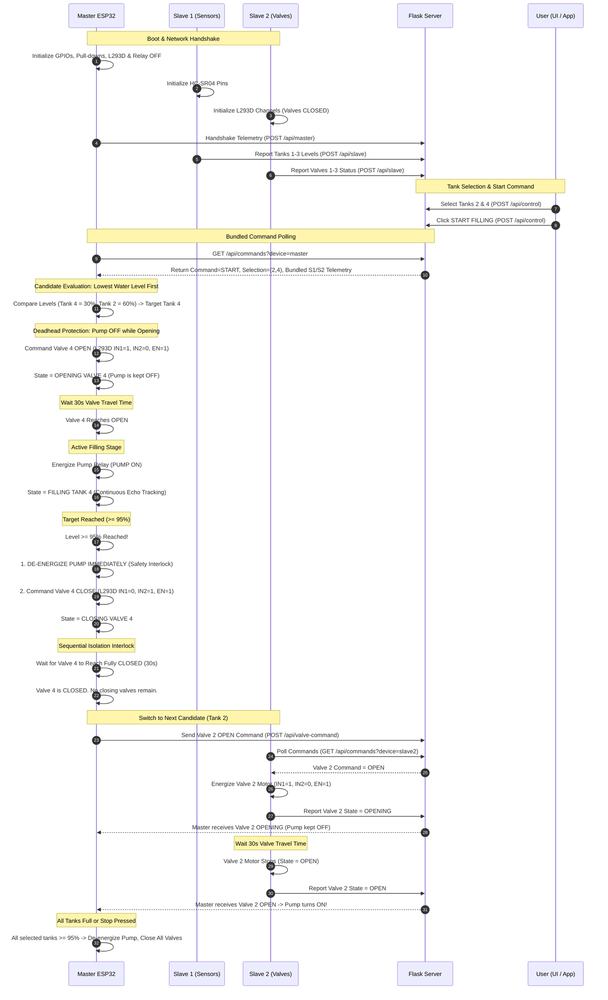
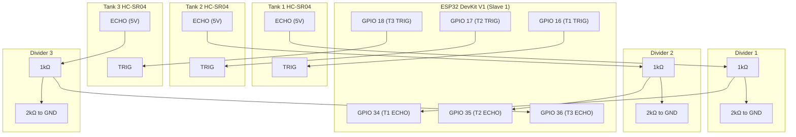
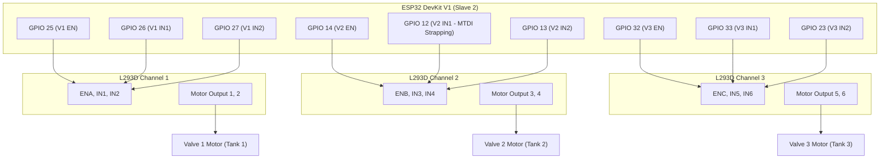

# Water Tank Management System V5
### Enterprise-Grade Multi-Node Automated Water Distribution & Monitoring Architecture

---

## 📋 Table of Contents
1. [Project Concept](#1-project-concept)
   - [System Vision](#system-vision)
   - [Hardware Responsibilities](#hardware-responsibilities)
   - [Decentralized Safety Philosophy](#decentralized-safety-philosophy)
2. [Project Flow](#2-project-flow)
   - [System Lifecycle & Sequence Diagram](#system-lifecycle--sequence-diagram)
   - [Priority & Candidate Selection Algorithm](#priority--candidate-selection-algorithm)
   - [Hydraulic Safety Interlocks](#hydraulic-safety-interlocks)
   - [Network Latency Optimization](#network-latency-optimization)
3. [Project Structure](#3-project-structure)
   - [Repository Directory Tree](#repository-directory-tree)
   - [Module-by-Module Description](#module-by-module-description)
4. [Master ESP32 Node Details](#4-master-esp32-node-details)
   - [Role & Responsibilities](#master-role--responsibilities)
   - [Hardware Pin Constraints](#master-hardware-pin-constraints)
   - [Master Wiring Table](#master-wiring-table)
   - [Master Wiring Diagram](#master-wiring-diagram)
   - [Firmware Architecture](#master-firmware-architecture)
5. [Slave 1 ESP32 Node Details (Ultrasonic Sensors)](#5-slave-1-esp32-node-details-ultrasonic-sensors)
   - [Role & Responsibilities](#slave-1-role--responsibilities)
   - [Voltage Divider Requirement](#slave-1-voltage-divider-requirement)
   - [Slave 1 Wiring Table](#slave-1-wiring-table)
   - [Slave 1 Wiring Diagram](#slave-1-wiring-diagram)
   - [Firmware Architecture](#slave-1-firmware-architecture)
6. [Slave 2 ESP32 Node Details (Motorized Valves)](#6-slave-2-esp32-node-details-motorized-valves)
   - [Role & Responsibilities](#slave-2-role--responsibilities)
   - [MTDI Strapping Pin Precaution](#slave-2-mtdi-strapping-pin-precaution)
   - [Slave 2 Wiring Table](#slave-2-wiring-table)
   - [Slave 2 Wiring Diagram](#slave-2-wiring-diagram)
   - [Firmware Architecture](#slave-2-firmware-architecture)
7. [Flask Backend & Web Dashboard](#7-flask-backend--web-dashboard)
   - [Architecture & Server Engine](#flask-architecture--server-engine)
   - [REST API Reference](#rest-api-reference)
   - [Centralized Fault Lifecycle Management](#centralized-fault-lifecycle-management)
   - [Web Dashboard UI Features](#web-dashboard-ui-features)
8. [Native Android Application](#8-native-android-application)
   - [Mobile Architecture & Tech Stack](#mobile-architecture--tech-stack)
   - [Key App Features](#key-app-features)
   - [Network Security Configuration](#network-security-configuration)
   - [Pre-compiled APK & Installation](#pre-compiled-apk--installation)
   - [Build Pipeline (Studio, CLI, CI/CD)](#build-pipeline)
9. [Pre-Flight Hardware Checklist](#9-pre-flight-hardware-checklist)

---

## 1. Project Concept

### System Vision
The **Water Tank Management System V5** is an industrial-grade, multi-node IoT solution engineered to automate water distribution across four overhead storage tanks (**Tanks 1, 2, 3, and 4**). The system eliminates manual valve operation, prevents catastrophic pump dry-running, avoids deadhead pressure bursts, and balances water consumption using real-time ultrasonic depth sensing.

The platform coordinates **three ESP32 DevKit V1 microcontrollers**, a centralized **Flask REST Backend**, a reactive **Web Dashboard**, and a **Native Android Application**.

```
+---------------------------------------------------------------------------------------+
|                                    LOCAL WI-FI (LAN)                                  |
|                             SSID: Airtel_NubeEra_Airtel                               |
+---------------------------------------------------------------------------------------+
           ▲                                  ▲                               ▲
           │ HTTP / JSON                      │ HTTP / JSON                   │ HTTP / JSON
           ▼                                  ▼                               ▼
+---------------------+            +---------------------+         +---------------------+
|    MASTER ESP32     |            |    SLAVE 1 ESP32    |         |    SLAVE 2 ESP32    |
| Central Coordinator |            | Level Sensing Node  |         | Actuator Valve Node |
|  - Pump Relay (P4)  |            |  - Tank 1 HC-SR04   |         |  - Valve 1 (L293D)  |
|  - Tank 4 Sensor    |            |  - Tank 2 HC-SR04   |         |  - Valve 2 (L293D)  |
|  - Valve 4 (L293D)  |            |  - Tank 3 HC-SR04   |         |  - Valve 3 (L293D)  |
|  - Switches S1-S4   |            +---------------------+         +---------------------+
|  - Buttons START/STP|
|  - Water Sensor     |
+---------------------+
           │
           │ HTTP POST /api/master (1s) & GET /api/commands (1s)
           ▼
+---------------------------------------------------------------------------------------+
|                                   FLASK REST SERVER                                   |
|                             Host: http://water.nubeera.com                             |
|  - In-Memory Data Registry        - Single-Trip Telemetry Bundling                    |
|  - Centralized Fault Lifecycle    - Command Dispatcher (Master / Slave 2)             |
+---------------------------------------------------------------------------------------+
           ▲                                                          ▲
           │ HTTP GET /api/dashboard (1s)                             │ HTTP GET /api/dashboard (1s)
           ▼                                                          ▼
+---------------------------------------+          +------------------------------------+
|             WEB DASHBOARD             |          |         NATIVE ANDROID APP         |
| Browser UI (HTML5 / Vanilla JS / CSS) |          | Kotlin / Jetpack / Retrofit / M3   |
|  - Live Level Fill Visualizations     |          |  - Native Progress Level Bars      |
|  - Exact Valve Text (Open/Close)      |          |  - Exact Valve Text (Open/Close)   |
|  - Material Tank Selectors            |          |  - Material Switches               |
|  - Diagnostics & Fault Resolution     |          |  - Diagnostics & Ping Test Tool    |
+---------------------------------------+          +------------------------------------+
```

### Hardware Responsibilities
| Device Node | Hardware Target | Primary Functional Scope |
| :--- | :--- | :--- |
| **Master ESP32** | ESP32 DevKit V1 (30-pin) | Central coordinator; reads Tank 4 ultrasonic depth; reads source water availability; controls high-power pump relay; controls motorized Valve 4 (L293D); reads 4 physical selector switches (S1–S4); reads physical START/STOP push buttons; executes autonomous hydraulic state machine. |
| **Slave 1 ESP32** | ESP32 DevKit V1 (30-pin) | Dedicated sensing node; samples three HC-SR04 ultrasonic sensors (Tanks 1, 2, and 3) through voltage dividers; converts echo travel time to percentage and distance; reports to `/api/slave` every 3 seconds. |
| **Slave 2 ESP32** | ESP32 DevKit V1 (30-pin) | Dedicated actuator node; drives three motorized ball valves (Valves 1, 2, and 3) via three L293D H-Bridge driver channels; executes non-blocking 30-second opening and closing timers; polls `/api/commands?device=slave2`. |
| **Flask Server** | Python 3.10+ / Werkzeug | Central hub; maintains state tables; bundles Slave 1 and Slave 2 telemetry for Master; manages active vs. resolved fault lifecycles; serves web dashboard and REST endpoints. |
| **Web Dashboard** | Responsive Web Application | Visualizes live tank fill percentages, exact valve status (`Opening`, `Open`, `Closing`, `Close`), physical vs. dashboard selection priority, and diagnostic remediation steps. |
| **Android App** | Native Kotlin Application (API 24–34) | Complete handheld control; displays live progress bars, valve text badges, tank selector switches, automation controls, and server configuration tool. |

### Decentralized Safety Philosophy
A critical engineering baseline in Version 5 is that **Master ESP32 remains the absolute physical authority for water-filling operations**. 
1. **Network Independence**: If Wi-Fi drops, Master halts the pump immediately. Safety decisions do not rely on remote cloud connectivity.
2. **Hardware Direct Control**: Physical switches and buttons on Master can initiate or stop operations regardless of dashboard availability.
3. **Hardware Verification**: All mock, verification, and dummy delay variables (`AUTOMATIC_FILLING_ENABLED`, `WATER_SENSOR_CONFIRMED`, `AUTOMATIC_VALVE_CONTROL_ENABLED`) have been completely removed. Code runs directly against physical pins.

---

## 2. Project Flow

### System Lifecycle & Sequence Diagram


### Priority & Candidate Selection Algorithm
When multiple tanks are selected (e.g., Tanks 1, 2, and 4), the firmware does not fill tanks arbitrarily. It applies an **Ascending Water-Level Evaluation**:
1. Filter out unselected tanks.
2. Filter out tanks with active sensor errors (`tank_sensor_ok == False` or `distance == None`).
3. Filter out tanks already satisfying full capacity ($\ge 95\%$).
4. Sort remaining candidate tanks ascending by percentage:
   $$\text{Candidate}_{\text{target}} = \min_{t \in \text{Candidates}} (\text{Level}_t)$$
5. The tank with the lowest water level begins filling first.

### Hydraulic Safety Interlocks
- **Deadhead Protection**: Motorized ball valves take 30 seconds to travel from 0° (fully closed) to 90° (fully open). Running a centrifugal pump against a closed or opening valve causes deadheading, leading to cavitational heating and pipe rupture. The pump relay is **strictly forced OFF** whenever the target valve is in the `OPENING` state.
- **Sequential Valve Isolation**: Opening multiple valves simultaneously splits pump discharge pressure and risks cross-contamination between tanks. The system enforces that a previous valve must report `CLOSED` before the next valve is energized.
- **Dry-Run Sump Protection**: The source water availability sensor (GPIO 32) continuously checks inlet water presence. If water is lost, the pump trips within 50 ms.
- **Travel Timeout Watchdog**: If any valve fails to complete movement within 40 seconds (30s nominal + 10s grace), the sequence halts, outputs are killed, and a critical timeout fault is flagged.

### Network Latency Optimization
In older implementations, Master performed 3 separate sequential HTTP transactions (`/api/commands`, `/api/dashboard`, `/api/master`) each second, producing over 600 ms of blocking network latency. 

In Version 5, the response to `GET /api/commands?device=master` packages:
- Dashboard START/STOP commands.
- Tank selection switches.
- Manual valve override signals.
- **Slave 1 Online state & Tanks 1–3 telemetry**.
- **Slave 2 Online state & Valves 1–3 states**.

This **halved network roundtrips**, dropping cycle communication overhead to under 50 ms.

---

## 3. Project Structure

### Repository Directory Tree
```
d:\nubeera\iot\arshadbhaijaan\V5
│
├── WaterTankV5.apk                      # Compiled Native Android APK (Release Ready, 6.34 MB)
├── setup_and_build_apk.ps1              # Automated SDK setup & APK compilation script
├── README.md                            # Comprehensive System Architecture & Engineering Guide
│
├── Master/
│   └── main.py                          # Master ESP32 MicroPython Firmware (Central Controller)
│
├── Slave 1/
│   └── main.py                          # Slave 1 ESP32 MicroPython Firmware (Sensors Tanks 1-3)
│
├── Slave 2/
│   └── main.py                          # Slave 2 ESP32 MicroPython Firmware (Valves 1-3 Actuators)
│
├── FlaskDashboard/
│   ├── Dockerfile                       # Container deployment definition (Port 5555)
│   ├── .dockerignore                    # Excludes venv, pycache, and logs from image
│   ├── app.py                           # Flask REST API Server & Central Fault Registry
│   ├── run.py                           # Flask Application Entrypoint (Default Port: 5555)
│   ├── requirements.txt                 # Python dependencies (Flask, requests, blinker)
│   ├── prompt.txt                       # Functional requirements specification
│   ├── static/
│   │   ├── style.css                    # Responsive CSS3 Stylesheet & Animated Status Badges
│   │   └── script.js                    # Web dashboard client script (API connector)
│   └── templates/
│       └── index.html                   # Dashboard UI with live status & fault views
│
├── WaterTankApp/                        # Full Native Android Project Source Code
│   ├── build.gradle.kts                 # Root Gradle configuration
│   ├── settings.gradle.kts              # Project structure declaration
│   ├── gradle.properties                # JVM & AndroidX optimization flags
│   ├── gradlew.bat                      # Windows Gradle wrapper script
│   ├── build_apk.ps1                    # Local build utility script
│   ├── README.md                        # Android app technical documentation
│   │
│   └── app/
│       ├── build.gradle.kts             # App dependencies (Retrofit, Material 3, Coroutines)
│       ├── proguard-rules.pro           # Code obfuscation & preservation rules
│       └── src/main/
│           ├── AndroidManifest.xml      # App permissions & security configuration
│           ├── java/com/nubeera/watertankv5/
│           │   ├── data/
│           │   │   ├── PreferencesManager.kt  # Server IP storage in SharedPreferences
│           │   │   ├── api/
│           │   │   │   ├── ApiClient.kt       # Dynamic Retrofit Client Singleton
│           │   │   │   └── WaterTankApiService.kt # REST API Interface
│           │   │   └── model/
│           │   │       └── DashboardModels.kt # Telemetry, command, and fault data classes
│           │   └── ui/
│           │       ├── MainActivity.kt        # Real-time dashboard controller
│           │       ├── MainViewModel.kt       # Coroutine background polling engine (1s)
│           │       ├── SettingsActivity.kt    # Server IP configuration & Ping test
│           │       ├── FaultsActivity.kt      # Diagnostic fault browser
│           │       └── adapter/
│           │           └── FaultAdapter.kt    # RecyclerView fault card adapter
│           └── res/
│               ├── layout/                    # Material 3 UI layouts
│               ├── values/                    # Strings, themes, and status colors
│               └── xml/                       # Network security config (cleartext HTTP)
│
└── .github/
    └── workflows/
        └── build-apk.yml                # Automated GitHub Actions Cloud CI/CD APK Builder
```

### Module-by-Module Description
- **`Master/main.py`**: Executes the autonomous hydraulic loop. Handles physical inputs, reads local Tank 4, drives Valve 4 via L293D, triggers the pump relay, monitors Wi-Fi, and polls bundled commands.
- **`Slave 1/main.py`**: Dedicated sensor collector. Performs non-blocking pulse measurement across Tanks 1, 2, and 3 with echo timeout bounds, builds structured payloads, and posts to `/api/slave`.
- **`Slave 2/main.py`**: Dedicated valve controller. Operates Valves 1, 2, and 3 via L293D motor drivers using non-blocking microsecond timers. Honors strapping pin constraints.
- **`FlaskDashboard/app.py`**: Thread-safe in-memory state engine. Implements the `/api/commands?device=master` bundled telemetry optimization, tracks active vs. resolved faults, and exposes REST endpoints.
- **`FlaskDashboard/templates/index.html`**: Zero-dependency browser dashboard. Features responsive flexbox layout, exact valve status text labels (`Close`, `Opening`, `Open`, `Closing`), and interactive tank selection badges.
- **`WaterTankApp/`**: Native Kotlin application for Android 7.0–14. Features real-time background polling, dynamic IP switching, material switches, and in-depth fault remediation steps.
- **`WaterTankV5.apk`**: 6.34 MB signed debug APK generated directly from source using Android SDK 34 and OpenJDK 17.

---

## 4. Master ESP32 Node Details

### Master Role & Responsibilities
Master acts as the brain of the water distribution setup:
- Reads Tank 4 water level via HC-SR04 ultrasonic sensor.
- Reads Source Water Availability Sensor (dry-run detection).
- Controls Pump motor relay (Active LOW).
- Controls motorized Valve 4 (L293D H-Bridge driver).
- Reads 4 physical selector switches (S1–S4).
- Reads physical START and STOP push buttons.
- Communicates with Flask server via Wi-Fi HTTP client.

### Master Hardware Pin Constraints
> [!IMPORTANT]
> **External Pull-Down Resistors Required on Pins 35, 36, 39**:
> On the ESP32 DevKit V1, GPIOs 34, 35, 36, and 39 are **Input-Only (GPI)** pins. They do **not** possess internal software pull-up or pull-down resistors. You **must** wire an external **10 kΩ pull-down resistor to GND** on each of these three switch lines (GPIO 35, 36, 39); otherwise, the inputs will float, causing random tank selection toggling.

> [!WARNING]
> **Voltage Divider on Tank 4 Echo (GPIO 34)**:
> The HC-SR04 ultrasonic sensor operates at 5V and outputs a 5V logic pulse on its `ECHO` pin. Connecting 5V directly to ESP32 GPIO 34 will degrade or destroy the pin. A voltage divider (1 kΩ in series with ECHO, 2 kΩ to GND) must step down the 5V signal to 3.3V.

### Master Wiring Table
| Component | Component Pin | ESP32 GPIO | Electrical Function | Hardware Notes |
| :--- | :--- | :--- | :--- | :--- |
| **Tank 4 HC-SR04** | VCC | 5V / Vin | 5V DC Power | Power from 5V rail |
| **Tank 4 HC-SR04** | GND | GND | Ground | Common Ground |
| **Tank 4 HC-SR04** | TRIG | **GPIO 18** | Digital Output | 10 µs trigger pulse |
| **Tank 4 HC-SR04** | ECHO | **GPIO 34** | Digital Input | **Requires 1kΩ / 2kΩ Voltage Divider (5V to 3.3V)** |
| **Switch 1 (Tank 1)** | Terminal 1 | **GPIO 35** | Digital Input | **Requires External 10kΩ Pull-Down to GND** |
| **Switch 1 (Tank 1)** | Terminal 2 | 3.3V | VCC | Switch ON connects GPIO to 3.3V |
| **Switch 2 (Tank 2)** | Terminal 1 | **GPIO 36** | Digital Input | **Requires External 10kΩ Pull-Down to GND** |
| **Switch 2 (Tank 2)** | Terminal 2 | 3.3V | VCC | Switch ON connects GPIO to 3.3V |
| **Switch 3 (Tank 3)** | Terminal 1 | **GPIO 39** | Digital Input | **Requires External 10kΩ Pull-Down to GND** |
| **Switch 3 (Tank 3)** | Terminal 2 | 3.3V | VCC | Switch ON connects GPIO to 3.3V |
| **Switch 4 (Tank 4)** | Terminal 1 | **GPIO 33** | Digital Input | Can use internal pull-down or external 10kΩ |
| **Switch 4 (Tank 4)** | Terminal 2 | 3.3V | VCC | Switch ON connects GPIO to 3.3V |
| **Water Availability** | OUT / Signal | **GPIO 32** | Digital Input | 1 = Water Available, 0 = Empty (Dry Run) |
| **Water Availability** | VCC & GND | 3.3V / GND | Power | Power from 3.3V rail |
| **Pump Relay Module**| IN | **GPIO 23** | Digital Output | **Active LOW**: 0 = Relay ON, 1 = Relay OFF |
| **Pump Relay Module**| VCC & GND | 5V / GND | Power | Optocoupler supply |
| **START Push Button** | Terminal 1 | **GPIO 16** | Digital Input | Active LOW (Internal PULL_UP configured) |
| **START Push Button** | Terminal 2 | GND | Ground | Button press connects to GND |
| **STOP Push Button**  | Terminal 1 | **GPIO 19** | Digital Input | Active LOW (Internal PULL_UP configured) |
| **STOP Push Button**  | Terminal 2 | GND | Ground | Button press connects to GND |
| **Valve 4 L293D**    | ENA (Pin 1)  | **GPIO 25** | Digital Output | H-Bridge Motor 4 Enable (1 = Active) |
| **Valve 4 L293D**    | IN1 (Pin 2)  | **GPIO 26** | Digital Output | Motor Direction 1 (1,0 = OPEN) |
| **Valve 4 L293D**    | IN2 (Pin 7)  | **GPIO 27** | Digital Output | Motor Direction 2 (0,1 = CLOSE) |
| **Valve 4 L293D**    | VCC1 (Pin 16)| 5V | Logic Power | 5V logic supply |
| **Valve 4 L293D**    | VCC2 (Pin 8) | 12V Ext | Motor Power | External 12V DC power for valve motor |
| **Valve 4 L293D**    | GND (Pins 4,5)| GND | Ground | Connect to Common Ground |

### Master Wiring Diagram

```mermaid
flowchart TD
    subgraph ESP32_Master["ESP32 DevKit V1 (Master)"]
        G18["GPIO 18 (TRIG)"]
        G34["GPIO 34 (ECHO)"]
        G35["GPIO 35 (S1)"]
        G36["GPIO 36 (S2)"]
        G39["GPIO 39 (S3)"]
        G33["GPIO 33 (S4)"]
        G32["GPIO 32 (Water Sensor)"]
        G23["GPIO 23 (Pump Relay)"]
        G16["GPIO 16 (START Button)"]
        G19["GPIO 19 (STOP Button)"]
        G25["GPIO 25 (V4 ENA)"]
        G26["GPIO 26 (V4 IN1)"]
        G27["GPIO 27 (V4 IN2)"]
    end

    subgraph Sensor_Tank4["Tank 4 HC-SR04"]
        T4_TRIG["TRIG"]
        T4_ECHO["ECHO"]
    end

    subgraph Resistor_Div4["Voltage Divider"]
        R1["1kΩ Resistor"]
        R2["2kΩ Resistor to GND"]
    end

    G18 --> T4_TRIG
    T4_ECHO --> R1 --> G34
    R1 --> R2

    subgraph Switches["Physical Selector Switches"]
        SW1["Switch 1 (Tank 1)"]
        SW2["Switch 2 (Tank 2)"]
        SW3["Switch 3 (Tank 3)"]
        SW4["Switch 4 (Tank 4)"]
        PD1["10kΩ Pull-Down"]
        PD2["10kΩ Pull-Down"]
        PD3["10kΩ Pull-Down"]
    end

    SW1 --> G35
    G35 --> PD1 --> GND
    SW2 --> G36
    G36 --> PD2 --> GND
    SW3 --> G39
    G39 --> PD3 --> GND
    SW4 --> G33

    subgraph Pump_Control["Pump Module"]
        RELAY["Active LOW Relay Module"]
        PUMP["Water Pump Motor (230V/12V)"]
    end

    G23 --> RELAY --> PUMP

    subgraph Buttons["Emergency Control"]
        BTN_START["START Button (Active LOW)"]
        BTN_STOP["STOP Button (Active LOW)"]
    end

    G16 --> BTN_START --> GND
    G19 --> BTN_STOP --> GND

    subgraph Valve4_Control["Valve 4 Actuator"]
        L293D_4["L293D Motor Driver"]
        V4_MOTOR["Motorized Ball Valve 4 (12V)"]
    end

    G25 --> L293D_4
    G26 --> L293D_4
    G27 --> L293D_4
    L293D_4 --> V4_MOTOR
```


### Master Firmware Architecture
Master's MicroPython script ([`Master/main.py`](file:///d:/nubeera/iot/arshadbhaijaan/V5/Master/main.py)) implements an event-driven cooperative scheduler executing at 50 ms loop ticks:
1. `process_physical_buttons()`: Debounces physical pushbuttons (50 ms threshold). Pressing START resets stop locks.
2. `read_physical_switches()`: Reads S1–S4. If a physical switch state changes, it raises `physical_selection_changed = True` to push the update to Flask.
3. `read_water_sensor()`: Samples GPIO 32. In case of water loss, trips the system immediately.
4. `read_tank4_distance()`: Pulses TRIG for 10 µs, catches echo pulse via `machine.time_pulse_us()`, and computes depth.
5. `poll_flask_commands()`: Queries `/api/commands?device=master`, ingests bundled sensor levels for Tanks 1–3, and tracks Slave 1 & Slave 2 heartbeat status.
6. `process_valve4_timer()`: Non-blocking 30-second timer handling Valve 4 opening/closing.
7. `automatic_controller()`: Executes candidate selection, lowest-level-first prioritization, deadhead safety, and sequential closing wait loops.
8. `send_master_telemetry()`: Posts full telemetry JSON to `/api/master` every 1000 ms.

---

## 5. Slave 1 ESP32 Node Details (Ultrasonic Sensors)

### Slave 1 Role & Responsibilities
Slave 1 ([`Slave 1/main.py`](file:///d:/nubeera/iot/arshadbhaijaan/V5/Slave%201/main.py)) monitors water levels for **Tanks 1, 2, and 3**:
- Fires triggers sequentially with a 250 ms delay between sensors to prevent cross-tank acoustic echo interference.
- Calculates water depth using project calibrations:
  $$\text{Level Percentage} = \frac{\text{Empty Distance (150 cm)} - \text{Measured Distance}}{\text{Empty Distance (150 cm)} - \text{Full Distance (10 cm)}} \times 100$$
- Transmits data and structured fault items to Flask (`/api/slave`) every 3000 ms.

### Slave 1 Voltage Divider Requirement
All three ultrasonic echo lines output 5V logic. **Voltage dividers must be installed on all three echo lines (GPIO 34, 35, 36).**

### Slave 1 Wiring Table
| Component | Component Pin | ESP32 GPIO | Electrical Function | Wiring Details |
| :--- | :--- | :--- | :--- | :--- |
| **Tank 1 HC-SR04** | VCC | 5V / Vin | 5V DC Supply | Common 5V rail |
| **Tank 1 HC-SR04** | GND | GND | Ground | Common Ground |
| **Tank 1 HC-SR04** | TRIG | **GPIO 16** | Digital Output | Trigger pulse |
| **Tank 1 HC-SR04** | ECHO | **GPIO 34** | Digital Input | **1kΩ / 2kΩ Voltage Divider (5V to 3.3V)** |
| **Tank 2 HC-SR04** | VCC | 5V / Vin | 5V DC Supply | Common 5V rail |
| **Tank 2 HC-SR04** | GND | GND | Ground | Common Ground |
| **Tank 2 HC-SR04** | TRIG | **GPIO 17** | Digital Output | Trigger pulse |
| **Tank 2 HC-SR04** | ECHO | **GPIO 35** | Digital Input | **1kΩ / 2kΩ Voltage Divider (5V to 3.3V)** |
| **Tank 3 HC-SR04** | VCC | 5V / Vin | 5V DC Supply | Common 5V rail |
| **Tank 3 HC-SR04** | GND | GND | Ground | Common Ground |
| **Tank 3 HC-SR04** | TRIG | **GPIO 18** | Digital Output | Trigger pulse |
| **Tank 3 HC-SR04** | ECHO | **GPIO 36** | Digital Input | **1kΩ / 2kΩ Voltage Divider (5V to 3.3V)** |

### Slave 1 Wiring Diagram


### Slave 1 Firmware Architecture
Slave 1 initializes all trigger pins to LOW, connects to Wi-Fi, and executes `read_all_tanks()` sequentially:
- Pulse duration timeout is bounded at 30,000 µs (maximum physical range ~500 cm).
- If the ultrasonic pulse times out or reads out of range (< 2 cm or > 400 cm), `distance` is set to `None`, `sensor` is marked `False`, and a structured fault object (`TANK_SENSOR_X`) is generated and dispatched to Flask.

---

## 6. Slave 2 ESP32 Node Details (Motorized Valves)

### Slave 2 Role & Responsibilities
Slave 2 ([`Slave 2/main.py`](file:///d:/nubeera/iot/arshadbhaijaan/V5/Slave%202/main.py)) operates motorized ball valves for **Tanks 1, 2, and 3**:
- Drives 3 bidirectional DC motors through an L293D quad half-H driver.
- Polls commands from `/api/commands?device=slave2` every 1000 ms.
- Manages independent non-blocking 30-second timers for opening and closing.
- Reports real-time valve positions (`CLOSED`, `OPENING`, `OPEN`, `CLOSING`) to `/api/slave` every 3000 ms.

### Slave 2 MTDI Strapping Pin Precaution
> [!CAUTION]
> **GPIO 12 Boot Strapping Pin Warning**:
> GPIO 12 on ESP32 is the **MTDI** strapping pin. If GPIO 12 is pulled HIGH during power-up or reset, the ESP32 selects an internal 1.8V flash voltage instead of 3.3V, causing **boot failure (SPI flash read error loop)**. 
> To guarantee boot success:
> 1. Ensure L293D pin `1A` (connected to GPIO 12) does not pull the line HIGH during startup.
> 2. Keep the L293D inputs un-energized during boot. The firmware explicitly configures GPIO 12 to output LOW upon startup.

### Slave 2 Wiring Table
| Valve Channel | Driver Pin | ESP32 GPIO | Logic Function | Operational Notes |
| :--- | :--- | :--- | :--- | :--- |
| **Valve 1 (Tank 1)** | EN1 (Pin 1) | **GPIO 25** | Digital Output | Motor 1 Enable (HIGH = Run) |
| **Valve 1 (Tank 1)** | 1A (Pin 2)  | **GPIO 26** | Digital Output | Direction A (1,0 = OPEN, 0,1 = CLOSE) |
| **Valve 1 (Tank 1)** | 2A (Pin 7)  | **GPIO 27** | Digital Output | Direction B |
| **Valve 2 (Tank 2)** | EN2 (Pin 9) | **GPIO 14** | Digital Output | Motor 2 Enable (HIGH = Run) |
| **Valve 2 (Tank 2)** | 3A (Pin 10) | **GPIO 12** | Digital Output | **MTDI Strapping Pin: Must be LOW during boot** |
| **Valve 2 (Tank 2)** | 4A (Pin 15) | **GPIO 13** | Digital Output | Direction B |
| **Valve 3 (Tank 3)** | EN3 (Pin 1) | **GPIO 32** | Digital Output | Motor 3 Enable (HIGH = Run) |
| **Valve 3 (Tank 3)** | 1A (Pin 2)  | **GPIO 33** | Digital Output | Direction A |
| **Valve 3 (Tank 3)** | 2A (Pin 7)  | **GPIO 23** | Digital Output | Direction B |
| **L293D Logic**      | VCC1 (Pin 16)| 5V / Vin   | Logic Supply   | 5V logic supply |
| **L293D Motor V+**   | VCC2 (Pin 8) | 12V Ext    | Motor Supply   | External 12V 2A Power Supply |
| **Common Ground**    | Pins 4,5,12,13| GND       | Ground Return  | Connect ESP32 GND and 12V PSU GND |

### Slave 2 Wiring Diagram


### Slave 2 Firmware Architecture
Slave 2 implements non-blocking state progression:
- When a command (`OPEN` or `CLOSE`) arrives for a valve, the motor pins are energized, the state transitions to `OPENING` or `CLOSING`, and a 30-second target deadline is recorded via `time.ticks_add(now, 30000)`.
- `process_valve_timers()` runs on every 50 ms loop iteration. Once `time.ticks_diff(now, deadline) >= 0`, driver pins are de-energized to 0V (stopping motor consumption), and status updates to `OPEN` or `CLOSED`.
- If an emergency `STOP` command arrives, all L293D channels drop to 0 immediately, locking valves in place.

---

## 7. Flask Backend & Web Dashboard

### Flask Architecture & Server Engine
The Flask backend ([`FlaskDashboard/app.py`](file:///d:/nubeera/iot/arshadbhaijaan/V5/FlaskDashboard/app.py)) serves as the centralized telemetry hub and command dispatcher:
- Multi-threaded request execution protected by re-entrant mutexes (`threading.RLock`).
- Default listening port configured to **`5555`** (configurable dynamically via `PORT` environment variable).
- Multi-container / cloud ready via the included [`Dockerfile`](file:///d:/nubeera/iot/arshadbhaijaan/V5/FlaskDashboard/Dockerfile) exposing port `5555` with automated `/api/health` healthchecks.
- Device telemetry timeout threshold set to 10 seconds. If an ESP32 node misses telemetry for $> 10$ seconds, it is flagged as `OFFLINE`.
- Full CORS and cleartext LAN capability enabled.

### REST API Reference

| Endpoint | Method | Source Caller | Description | Payload Example |
| :--- | :--- | :--- | :--- | :--- |
| `/api/master` | `POST` | Master ESP32 | Ingests Master telemetry (Tank 4, Pump, Switches, Buttons, System Mode). | `{"device":"master","ip":"192.168.1.101","pump":{"running":false},"tank4":{"level":75}}` |
| `/api/slave` | `POST` | Slave 1 & Slave 2 | Ingests sensor data from Slave 1 or valve states from Slave 2. | `{"device":"slave1","tank1":{"level":40},"tank2":{"level":80},"tank3":{"level":95}}` |
| `/api/commands` | `GET` | Master & Slave 2 | Command polling endpoint. Parameter `?device=master` returns bundled commands and slave data; `?device=slave2` returns valve movement commands. | *Master returns:* `{"command":"START","slave1Online":true,"slaveTanks":{...}}` |
| `/api/control` | `POST` | Dashboard / App | Dispatches operator commands (`START`, `STOP`, `tankSelection`). | `{"command":"START","tankSelection":{"s1":true,"s2":false,"s3":false,"s4":true}}` |
| `/api/valve-command` | `POST` | Master / Dashboard | Queues manual or automated valve movement commands. | `{"valve":2,"command":"OPEN"}` |
| `/api/dashboard` | `GET` | Dashboard / App | Delivers unified state snapshot across all 4 tanks, 4 valves, pump, and fault lists. | See schema below |
| `/api/faults` | `GET` | Dashboard / App | Returns list of currently active faults. | `{"success":true,"activeFaults":[...]}` |
| `/api/faults/history`| `GET` | Dashboard / App | Returns list of resolved historical faults. | `{"success":true,"faultHistory":[...]}` |
| `/api/health` | `GET` | Mobile App / Diagnostics| Connection and latency check. | `{"success":true,"service":"Water Tank System V5"}` |

#### Unified Dashboard Payload Sample (`GET /api/dashboard`)
```json
{
  "master": { "online": true, "ip": "192.168.1.101", "lastUpdate": 1730524000 },
  "slave1": { "online": true, "ip": "192.168.1.102", "lastUpdate": 1730524000 },
  "slave2": { "online": true, "ip": "192.168.1.103", "lastUpdate": 1730524000 },
  "controller": { "state": "FILLING TANK 2", "cycleRunning": true, "activeTank": 2 },
  "pump": { "running": true, "state": "ON" },
  "tank1": { "distance": 45.0, "level": 75, "sensor": true },
  "tank2": { "distance": 80.0, "level": 50, "sensor": true },
  "tank3": { "distance": 20.0, "level": 92, "sensor": true },
  "tank4": { "distance": 15.0, "level": 96, "sensor": true },
  "valves": [
    { "id": 1, "state": "CLOSED", "error": false },
    { "id": 2, "state": "OPEN", "error": false },
    { "id": 3, "state": "CLOSED", "error": false },
    { "id": 4, "state": "CLOSED", "error": false }
  ],
  "switches": { "s1": true, "s2": true, "s3": false, "s4": true },
  "selectionSource": "DASHBOARD",
  "faults": [],
  "timestamp": 1730524000
}
```

### Centralized Fault Lifecycle Management
The backend maintains a dynamic state registry tracking faults through their entire lifecycle:
- **Active State**: Registered when an anomaly is observed (e.g., node offline, echo signal missing, dry run detected).
- **Resolved State**: When telemetry normalizes, the fault automatically transitions from Active to Resolved with a recorded resolution timestamp.
- **Deduplication**: Duplicate alerts are combined; `occurrence_count` increments while tracking `first_seen` and `last_seen` timestamps.

### Web Dashboard UI Features
- **Live Fill Columns**: Graphic representation of tank depth with percentage badges and distance measurements.
- **Clean Valve Status**: Displays exact real-time text labels:
  - **`Opening`**: Warm amber badge with animated pulsing glow.
  - **`Open`**: Vibrant green badge.
  - **`Closing`**: Indigo badge with animated pulsing glow.
  - **`Close`**: Clean neutral slate gray badge.
- **Selection Source Tag**: Explicitly flags whether tank selections originate from physical toggles on the Master controller (`Source: PHYSICAL`) or browser clicks (`Source: DASHBOARD`).
- **Interactive Automation Bar**: START and STOP controls with feedback toasts.

---

## 8. Native Android Application

### Mobile Architecture & Tech Stack
The Android application ([`WaterTankApp/`](file:///d:/nubeera/iot/arshadbhaijaan/V5/WaterTankApp)) is a 100% native Kotlin implementation designed for field supervision:
- **Architecture**: MVVM (Model-View-ViewModel) with Android Architecture Components.
- **Networking**: Retrofit 2 + OkHttp 3 with logging interceptors and 3-second connect/read timeouts.
- **Concurrency**: Kotlin Coroutines (`viewModelScope`) executing background polling loops every 1000 ms.
- **Design System**: Material Design 3 (Material Components 1.12) featuring high-contrast surface colors, card elevation, and responsive grid layouts.

### Key App Features
1. **Live Tank Gauges**: Visual horizontal percentage bars with color transitions (amber when low, blue when normal, green when full).
2. **Valve Telemetry Badges**: Exact status text representation matching the physical system (`Opening`, `Open`, `Closing`, `Close`).
3. **Hardware Connectivity Card**: Displays IP addresses and health tags for Master, Slave 1, and Slave 2.
4. **Interactive Tank Selection Switches**: S1–S4 toggles with mutual two-way binding with the Flask backend.
5. **Diagnostics & Troubleshooting Sheet**: Tap to view active diagnostic records complete with probable causes and numbered troubleshooting steps.
6. **Server IP Settings with Ping Tool**: Settings screen to configure the Flask Server URL (`http://water.nubeera.com`) with an instant connectivity test before saving.

### Network Security Configuration
Android 9 (API 28) and higher blocks unencrypted cleartext HTTP by default. To allow communication over local private Wi-Fi networks without requiring SSL certificates, the app includes:

```xml
<!-- app/src/main/res/xml/network_security_config.xml -->
<?xml version="1.0" encoding="utf-8"?>
<network-security-config>
    <base-config cleartextTrafficPermitted="true">
        <trust-anchors>
            <certificates src="system" />
        </trust-anchors>
    </base-config>
</network-security-config>
```

And in `AndroidManifest.xml`:
```xml
android:usesCleartextTraffic="true"
android:networkSecurityConfig="@xml/network_security_config"
```

### Pre-compiled APK & Installation
A compiled, signed debug APK is ready for deployment:
- **Location**: [`WaterTankV5.apk`](file:///d:/nubeera/iot/arshadbhaijaan/V5/WaterTankV5.apk) (Root directory)
- **File Size**: 6.34 MB

#### Installation Steps:
1. Transfer `WaterTankV5.apk` to your Android device via USB, WhatsApp, or Google Drive.
2. Open the file on your device and tap **Install** (allow *Install unknown apps* if prompted).
3. Connect your phone to the same Wi-Fi router as the Flask server (`Airtel_NubeEra_Airtel`).
4. Launch **Water Tank V5**. The default server URL is pre-configured to `http://water.nubeera.com`. You can test connection under Settings.

### Build Pipeline

#### 1. Android Studio (1 Click):
1. Open Android Studio &rarr; **Open** &rarr; Select `D:\nubeera\iot\arshadbhaijaan\V5\WaterTankApp`.
2. Allow Gradle to synchronize dependencies.
3. Select **Build &rarr; Build Bundle(s) / APK(s) &rarr; Build APK(s)**.

#### 2. Local Command Line (PowerShell):
Run the provided automated script:
```powershell
powershell -ExecutionPolicy Bypass -File "D:\nubeera\iot\arshadbhaijaan\V5\setup_and_build_apk.ps1"
```

#### 3. Cloud CI/CD (GitHub Actions):
The repository contains [`.github/workflows/build-apk.yml`](file:///d:/nubeera/iot/arshadbhaijaan/V5/.github/workflows/build-apk.yml). Pushing this project to GitHub triggers an automated build runner that compiles the APK and attaches it to the workflow summary for direct download.

---

## 9. Pre-Flight Hardware Checklist

Before energizing the 230V pump and 12V valve power supplies, verify the following electrical safety checks:

- [ ] **External Pull-Down Resistors (Master)**: Verify that **10 kΩ resistors** are wired from GPIO 35, GPIO 36, and GPIO 39 to GND.
- [ ] **Voltage Dividers on Ultrasonic Echo Pins**: Verify that **1 kΩ / 2 kΩ resistor dividers** are wired on the ECHO lines of all four sensors (Master GPIO 34; Slave 1 GPIO 34, 35, 36) to step 5V signals down to 3.3V.
- [ ] **Slave 2 MTDI Pin (GPIO 12)**: Ensure GPIO 12 is not pulled HIGH by external circuitry at power-on to prevent bootloader loop failure.
- [ ] **Common Ground Plane**: Verify that the GND rails of all three ESP32 boards, the 5V logic power supply, and the 12V motor power supply are bonded together into a single common ground.
- [ ] **Flask Server Endpoint Verification**: All devices and the mobile app are pre-configured to `http://water.nubeera.com`. Ensure the ESP32 boards are connected to a Wi-Fi router with active internet access.

---

*Water Tank Management System V5 &bull; Engineering Documentation &bull; Antigravity Advanced Agentic Coding*

